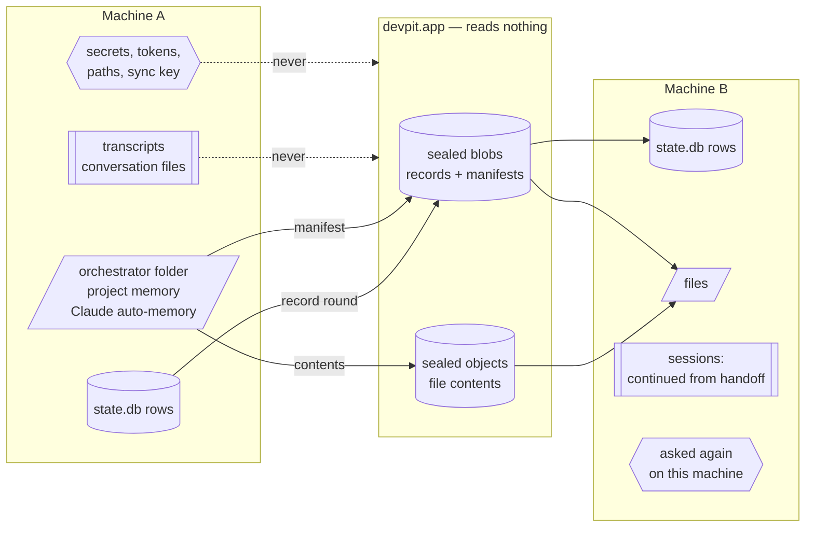
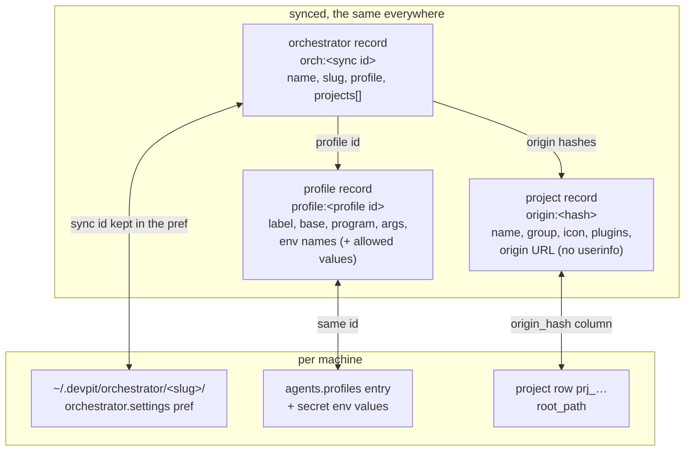
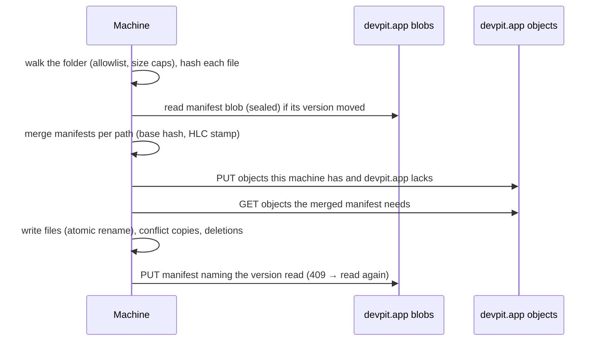
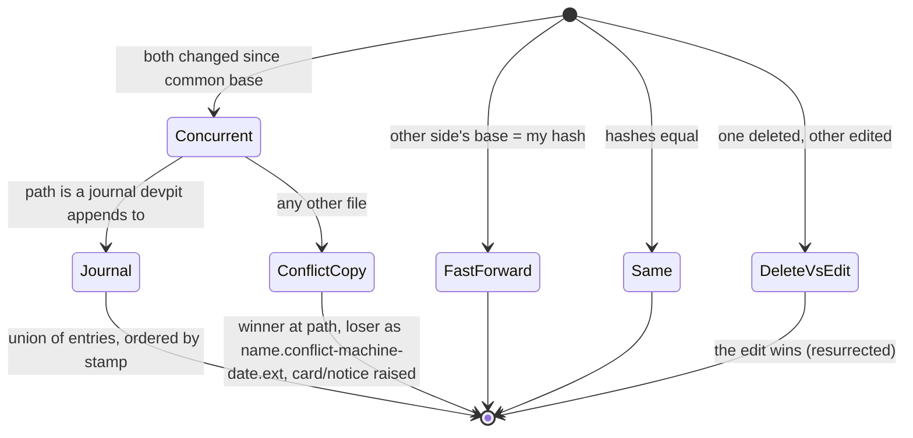
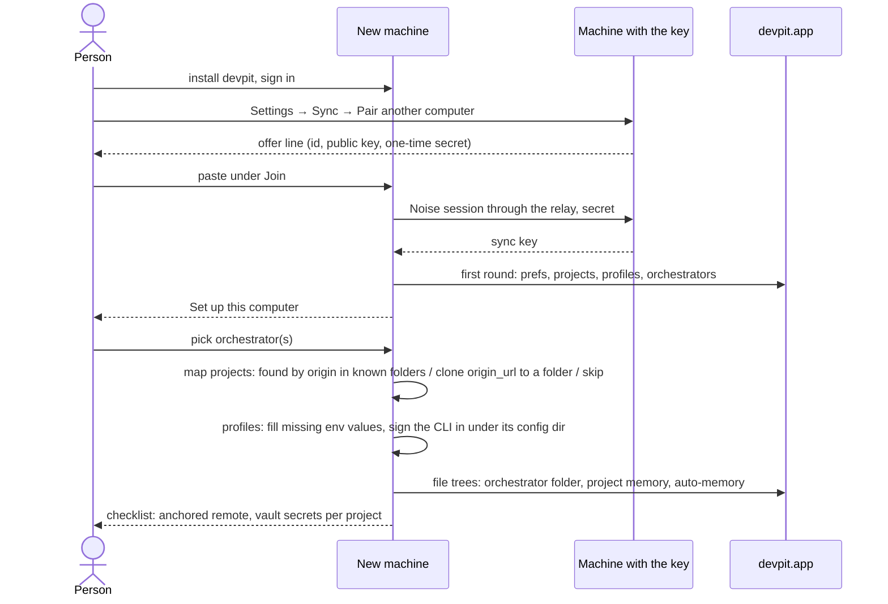

# Sync of the person's workspace — design

Status: **proposed**, waiting on the [open questions](#open-questions).
Decision record: [ADR 0001](adr/0001-sync-the-persons-workspace.md).
Builds on [`sync.md`](sync.md), which this design extends and does not repeat.

The goal, in the person's words: *sync here, then on a new PC pick the
orchestrator and bring its configs*, and keep the same context and memory on
both machines.

## What travels, and how

| class | examples | how it travels | merge |
|---|---|---|---|
| **records** | prefs, project settings, machines (today); profiles, orchestrators, project links (new); board (#198, later) | one sealed blob per namespace, the existing round | field by field, later HLC stamp wins |
| **files** | orchestrator notes, project memory, Claude Code auto-memory | new *file tree*: a sealed manifest blob + sealed content-addressed objects | per file; concurrent edits keep both; journals union |
| **sessions** | Claude transcripts, devpit's `sessions/*.jsonl`, the orchestrator's chat | do not sync | — continued from synced notes |
| **local only** | vault, token files, sync key, worktrees, runs, caches, absolute paths | never leave | — |

## Identity across machines

Nothing that crosses machines is a path or a `prj_`/`card_` id: each machine
mints its own. Links are written in sync ids and resolved on arrival.

- **Project** — the hash of its normalised git origin, as today
  (`project.origin_hash`). Two fixes first, because it becomes the only
  project identity that crosses: normalise `user@` other than `git@`, ports,
  and `.git/`; recompute the hash when `remote.origin.url` changes (today it
  is computed only at insert). The record gains the **origin URL** without
  userinfo, so a machine missing the project can offer to clone it.
  A project with no origin stays local (as today), unless the person links it
  by name on the second machine (open question 3).
- **Profile** — its `id` is already minted once and never derived from the
  label, so it is the sync id as it is.
- **Orchestrator** — today its identity is its folder path, and its links are
  the preference `orchestrator.settings:<absolute path>` holding
  `{profile, projects: [prj_…]}`. It gains a minted sync id kept in that
  value; the record carries the folder's slug, the profile id and the
  projects as origin hashes. A migration fills the sync id and translates the
  project ids it can.

## Records: the new namespaces

Each is a namespace of the existing round (`crates/sync/src/space.rs`), with
an allowlist and a test that fails when a field is added without a decision,
as `prefs.rs` does today.

### `profiles`

| field | syncs | note |
|---|---|---|
| `label`, `base`, `args`, `models` | yes | |
| `command` | yes when it is a bare program name; dropped when absolute | an absolute path is this machine's |
| `env[].name` | yes, all | the new machine knows what to ask for |
| `env[].value` | only for names on an allowlist | `CLAUDE_CONFIG_DIR` (rewritten to `~/…`), `*_BASE_URL`, `*_MODEL*`, `API_TIMEOUT_MS`; every other value arrives empty |

A profile with empty values shows *needs N values on this computer* and is
not offered to start until they are filled. `agents.default` stays local (it
names what this machine opens).

### `orchestrators`

| field | syncs |
|---|---|
| `slug` (folder name), display name | yes |
| `profile` (profile id) | yes; a machine without that profile asks which to use |
| `projects` (origin hashes) | yes; each resolved to a local project or listed as *not on this computer* |
| sync id of its file tree | yes |

### `projects` (existing) gains

`origin_url` (userinfo stripped, sealed like the rest) and, if question 3
says so, a `link` for projects without origin.

## Files: the file tree namespace

One file tree per synced folder: an orchestrator's folder, a project's
memory folder, one Claude auto-memory folder per (profile, project).

- **Manifest** — a sealed blob in the round's format: one record per path,
  fields `hash`, `size`, `mode`, `base` (the hash this machine last saw for
  the path), stamped by the HLC. A deletion is a cleared `hash` (tombstone).
  Paths are relative to the folder; nothing absolute is kept.
- **Objects** — file contents sealed with the same key, named by
  HMAC(names key, content hash), immutable. devpit.app sees opaque names and
  sizes. Garbage collection is the client's: a machine lists the account's
  objects and deletes those no manifest reaches, after a grace period.
- **Conflicts** — when a machine finds the merged winner was written from a
  `base` that is not the version it holds, both changed the file apart:

  Journals are the files devpit itself appends dated sections to:
  `context/sessions.md`, the log part of `context/preferences.md`. Everything
  else (`CLAUDE.md`, `decisions/`, `docs/`, `context/projects/*.md`) keeps
  both copies: a silent text merge of instructions is worse than a visible
  duplicate.

### The orchestrator folder, file by file

| path | syncs | why |
|---|---|---|
| `CLAUDE.md` ("Mine" section) | yes | the person's own instructions |
| `.devpit/orchestrator.md` | **no** | rewritten by each build; each machine writes its own |
| `.devpit/orchestrator.json` | no | legacy, read once; holds local ids |
| `context/projects/*.md`, `context/preferences.md`, `context/handoff-*.md` | yes | the orchestrator's memory |
| `context/sessions.md` | yes, as a journal | appended on both machines |
| `context/now.md` | **no** | regenerated every turn from this machine's state |
| `decisions/`, `docs/` | yes | |
| `artifacts/` | open question 1 | 189 of 221 MB today |
| `.git/`, `.playwright-mcp/`, `.gitignore` | no | tool state |

Absolute paths inside notes (`/home/jhol/...`) are left as written: they are
text the agent wrote. The brief devpit seeds will tell agents to write
`~`-relative paths from now on.

### Project memory

There is no project memory feature in the code today (no table, no folder;
the epic's M-01..M-10 never landed). What acts as one now is the
orchestrator's `context/projects/<name>.md` and Claude's auto-memory. This
design gives it a home that syncs: `projects/<folder>/memory/` under devpit's
home, a file tree per project keyed by origin hash. Whether that folder is a
new feature of this release or waits is open question 4.

## Claude Code on the other machine

| piece | where | syncs? | why |
|---|---|---|---|
| transcripts `projects/<enc cwd>/<id>.jsonl` | `CLAUDE_CONFIG_DIR` | **no** | 2.6 GB on one profile, one session up to 46 MB; every line carries absolute cwd; tool outputs may hold secrets; `--resume` looks under the encoded cwd of *this* machine |
| auto-memory `projects/<enc cwd>/memory/*.md` | `CLAUDE_CONFIG_DIR` | **yes**, as a file tree per (profile, project origin) | small markdown; written to the encoded folder of the project's local path on each machine |
| user `CLAUDE.md` in the config dir | `CLAUDE_CONFIG_DIR` | open question 6 | the person's global instructions per account |
| `settings.json`, hooks, plugins, credentials | `CLAUDE_CONFIG_DIR` | **no** | machine paths, tokens, sign-in |
| devpit conversation files `projects/<folder>/sessions/` | devpit home | **no** | they point at a Claude session that does not exist on the other machine |
| card handoff | `card_comment` | with the board (#198) | the way work resumes elsewhere |
| anchored memory | `~/.anchored/data/anchored.db` | **no, by devpit** | 5.2 GB, local embeddings, its own remote sync (`remote:` in its config); bootstrap points at it |

So "continue on the other machine" means: the orchestrator starts fresh on
B, reads the same folder (its memory), the same project notes and the same
auto-memory, and the card's handoff says where the work stopped. It is not
the same Claude session. An opt-in *carry this session* (export one
transcript, rewrite its cwd, import under B's encoded path) is possible but
fragile and is left for after (open question 5).

## What stays local

- The vault (`.env`, values) and every token file under devpit's home
  (`account-token`, `hook-auth`, `decisions-key`, `transcribe-key`,
  `telegram*.json`, `remote-*.json`, `plus-entitlement`, `sync-key.json`).
- Profile env values outside the allowlist.
- Absolute paths: `root_path`, worktrees, `card.worktree_path`, attachment
  paths, `run.cwd`, the `orchestrator.settings:<path>` key itself.
- Runs, reports, review runs, devflow locks, caches (`session_text`,
  `session_file`, `cli-init/`), `browser/`, `taps/`.
- Each machine's `agents.default`, window and tray state (as today).

## A new machine

Finding a project already on disk: scan the folders the person names (and
the parents of projects B already knows) for git checkouts whose origin hash
matches; never the whole disk.

## Size and devpit.app

- Records keep today's caps (1 MiB a blob, 16 MiB an account).
- Objects need a store of their own: new routes
  `GET/PUT/DELETE /v1/sync/objects/{name}` and a listing, a per-object cap
  (proposed 25 MiB) and a per-account quota (open question 2). Postgres
  `bytea` is enough for notes; artifacts at today's size want object storage
  (R2 on the existing Cloudflare account).
- A machine refuses to upload past the caps before a byte leaves it, and a
  file over the per-object cap stays local with a notice.

## Open questions

1. **Artifacts.** `artifacts/` is 189 MB of 221 MB in one orchestrator.
   (a) not synced; (b) synced up to a size per file (e.g. 5 MB) and the rest
   local; (c) all synced, which needs object storage and a quota.
   *Recommendation: (b), with a "keep local" marker per folder.*
2. **Quota and who pays.** Free accounts get notes only (a few hundred MB);
   artifacts and larger quotas are devpit Plus? Or one generous quota for
   everyone for now? *Recommendation: notes free, artifacts behind Plus.*
3. **Projects without a git origin** (or "by project name"). Link by name
   when the person confirms on the second machine, or leave them local as
   today? *Recommendation: local, with a manual "this is the same as" link.*
4. **Project memory.** Add a real `projects/<folder>/memory/` in this
   release (and have agents write to it), or sync only what exists
   (orchestrator `context/projects/*.md` and Claude auto-memory)?
   *Recommendation: sync what exists first; the feature later.*
5. **Carrying a live session.** Is "continue from the handoff, not the same
   Claude session" acceptable, or is opt-in transcript export/import worth
   building? *Recommendation: handoff only.*
6. **Claude's user-level `CLAUDE.md`** per config dir (e.g.
   `~/.claude-claudin/CLAUDE.md`): sync it with the profile, or leave it to
   the person? *Recommendation: sync, as a one-file tree per profile.*
7. **Anchored.** devpit only reminds the person to turn on anchored's
   personal remote on the new machine, or does devpit host an anchored
   remote for the account? *Recommendation: remind only.*
8. **Two machines running the same orchestrator at once.** Allow it (journals
   union, other files conflict copies), or let one machine "hold" an
   orchestrator and show it read-only elsewhere? *Recommendation: allow,
   with a banner when another machine wrote in the last minutes.*
9. **Profile secrets.** Never sync them (ask on each machine), or offer an
   opt-in sealed "secrets" namespace under the same key?
   *Recommendation: never, in line with the vault rule.*
10. **Order against the board (#198).** Ship workspace sync first and the
    board after, or the board first? *Recommendation: workspace first; the
    board needs card numbers that do not collide, a bigger change.*

## Proposed cards (after the decisions)

1. Project identity that crosses: fix origin normalisation, recompute on
   remote change, `origin_url` in the `projects` namespace.
2. Orchestrator sync id and links by origin hash (store migration from the
   path-keyed preference), `orchestrators` namespace.
3. `profiles` namespace with the env allowlist and *needs values here*.
4. devpit-app: sealed objects store, routes, caps, quota (and R2 if q1/q2
   say so).
5. File tree engine in `crates/sync`: manifest, objects, conflict copies,
   journals, GC; tests in the style of `concurrent_edits_settle_the_same_everywhere.rs`.
6. Orchestrator folder sync on that engine, with the file-by-file allowlist.
7. Claude auto-memory sync per (profile, project), written to the local
   encoded path.
8. *Set up this computer*: pick orchestrator, map projects (find, clone,
   skip), fill profiles, checklist.
9. The UI says what continues and what does not (handoff, not session).
10. Board sync (#198), on the same identity rules.
