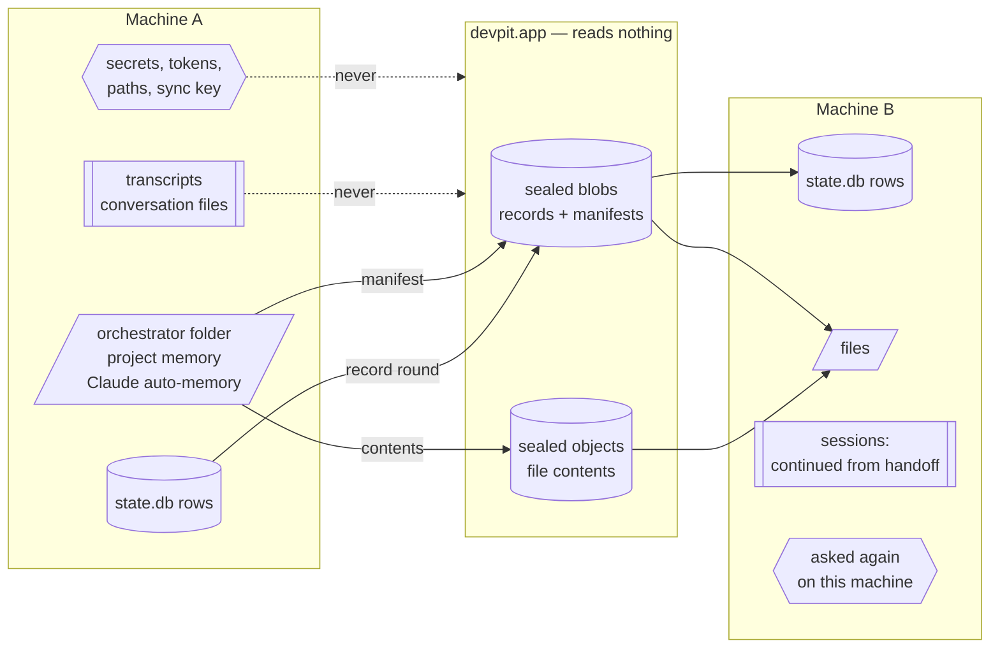
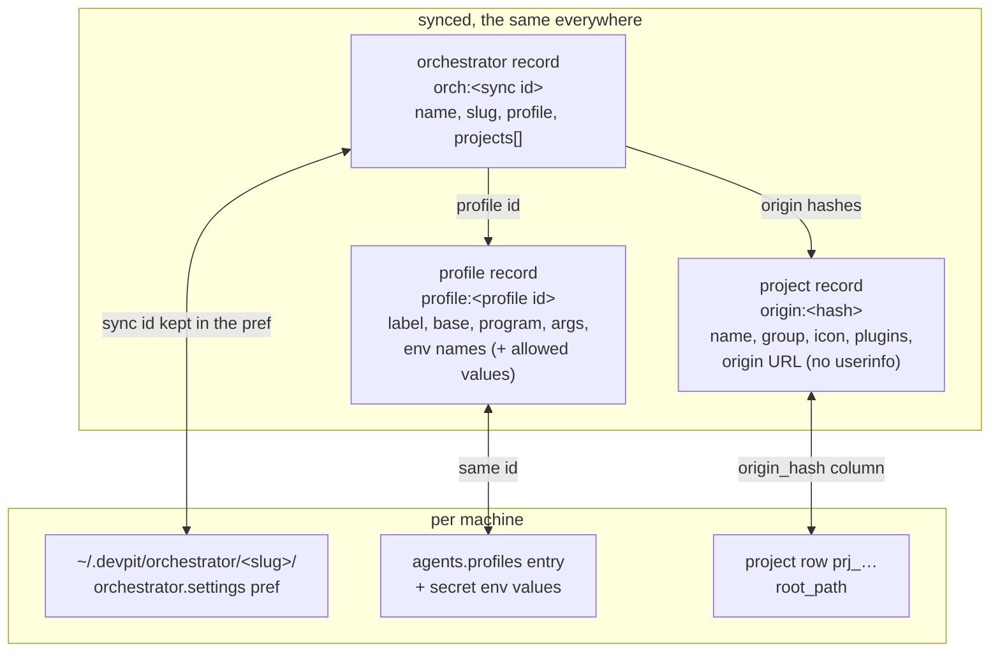
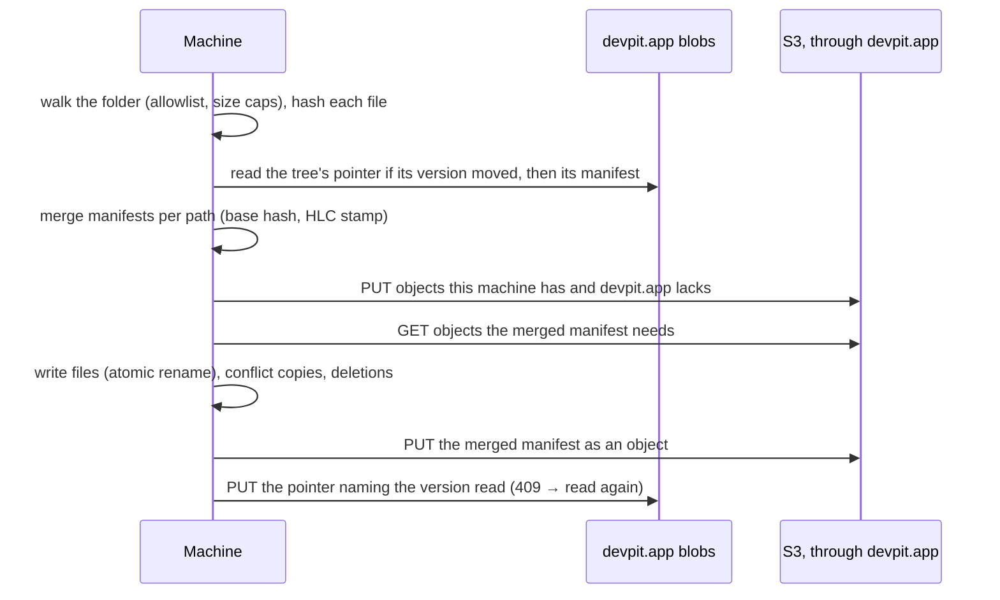
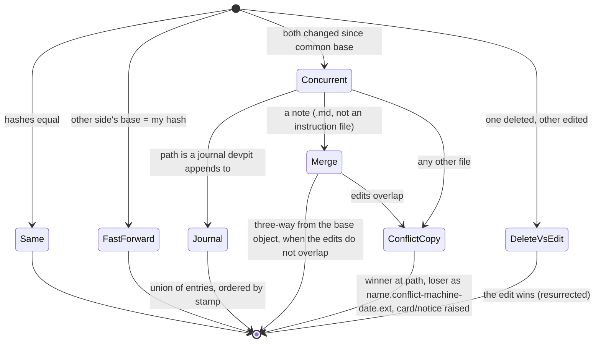
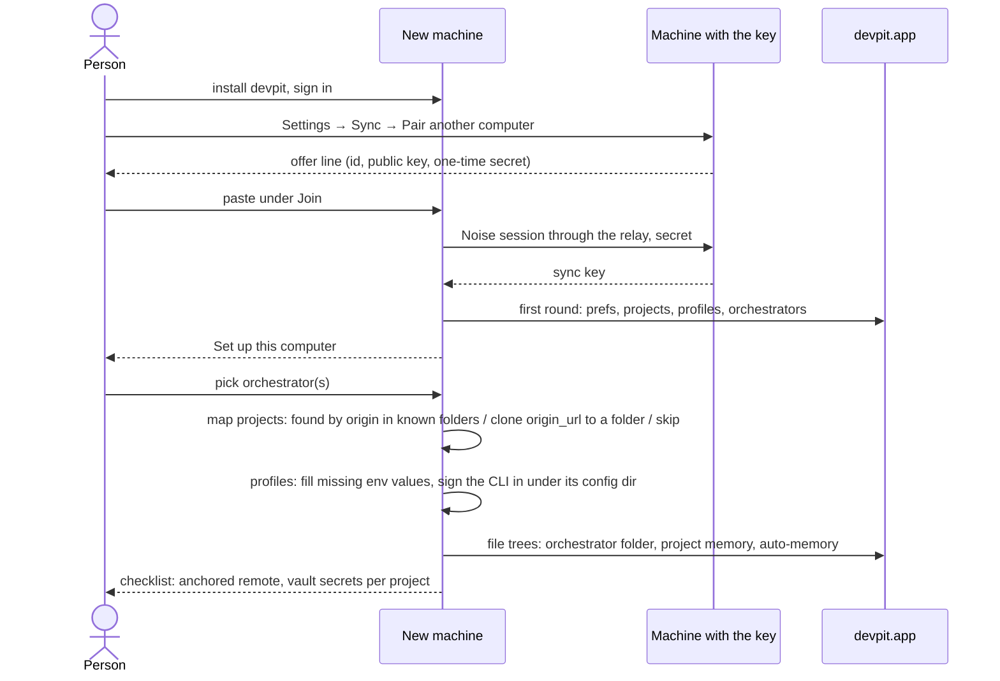

# Sync of the person's workspace — design

Status: **accepted** 2026-10-28 ([decisions](#decisions)); file contents on
[S3](#objects-on-s3).
Decision record: [ADR 0001](adr/0001-sync-the-persons-workspace.md).
Builds on [`sync.md`](sync.md), which this design extends and does not repeat.

The goal, in the person's words: *sync here, then on a new PC pick the
orchestrator and bring its configs*, and keep the same context and memory on
both machines.

## What travels, and how



| class | examples | how it travels | merge |
|---|---|---|---|
| **records** | prefs, project settings, machines (today); profiles, orchestrators, project links (new); board (#198, later) | one sealed blob per namespace, the existing round | field by field, later HLC stamp wins |
| **files** | orchestrator notes, project memory, Claude Code auto-memory | new *file tree*: a sealed manifest blob + sealed content-addressed objects | per file; concurrent edits keep both; journals union |
| **sessions** | Claude transcripts, devpit's `sessions/*.jsonl`, the orchestrator's chat | do not sync | — continued from synced notes |
| **local only** | vault, token files, sync key, worktrees, runs, caches, absolute paths | never leave | — |

## Identity across machines

Nothing that crosses machines is a path or a `prj_`/`card_` id: each machine
mints its own. Links are written in sync ids and resolved on arrival.



- **Project** — the hash of its normalised git origin, as today
  (`project.origin_hash`). Two fixes first, because it becomes the only
  project identity that crosses: normalise `user@` other than `git@`, ports,
  and `.git/`; recompute the hash when `remote.origin.url` changes (today it
  is computed only at insert). The record gains the **origin URL** without
  userinfo, so a machine missing the project can offer to clone it.
  A project with no origin stays local (as today), unless the person links it
  by hand on the second machine (decision 3).
- **Profile** — its `id` is already minted once and never derived from the
  label, so it is the sync id as it is.
- **Orchestrator** — today its identity is its folder path, and its links are
  the preference `orchestrator.settings:<absolute path>` holding
  `{profile, projects: [prj_…]}`. It gains a minted sync id kept in that
  value; the record carries the folder's slug, the profile id and the
  projects as origin hashes. A migration fills the sync id and translates the
  project ids it can.

## Records: the new namespaces

Each is a namespace of the existing round (`crates/sync/src/space.rs`), with
an allowlist and a test that fails when a field is added without a decision,
as `prefs.rs` does today.

### `profiles`

| field | syncs | note |
|---|---|---|
| `label`, `base`, `args`, `models` | yes | |
| `command` | yes when it is a bare program name; dropped when absolute | an absolute path is this machine's |
| `env[].name` | yes, all | the new machine knows what to ask for |
| `env[].value` | only for names on an allowlist | `CLAUDE_CONFIG_DIR` (rewritten to `~/…`), `*_BASE_URL`, `*_MODEL*`, `API_TIMEOUT_MS`; every other value arrives empty |

A profile with empty values shows *needs N values on this computer* and is
not offered to start until they are filled. `agents.default` stays local (it
names what this machine opens).

### `orchestrators`

| field | syncs |
|---|---|
| `slug` (folder name), display name | yes |
| `profile` (profile id) | yes; a machine without that profile asks which to use |
| `projects` (origin hashes) | yes; each resolved to a local project or listed as *not on this computer* |
| sync id of its file tree | yes |

### `projects` (existing) gains

`origin_url` (userinfo stripped, sealed like the rest) and, if question 3
says so, a `link` for projects without origin.

## Files: the file tree namespace

One file tree per synced folder: an orchestrator's folder, a project's
memory folder, one Claude auto-memory folder per (profile, project).



- **Manifest** — a sealed object (see [manifests and snapshots](#objects-on-s3)): one record per path,
  fields `hash`, `size`, `mode`, `base` (the hash this machine last saw for
  the path), stamped by the HLC. A deletion is a cleared `hash` (tombstone).
  Paths are relative to the folder; nothing absolute is kept.
- **Objects** — file contents sealed with the same key, named by
  HMAC(names key, content hash), immutable, stored in S3
  ([below](#objects-on-s3)). The object's name is sealed in as associated
  data, and the manifest binds path → hash, so a server cannot hand one
  file's content back under another path. devpit.app sees opaque names and
  sizes.
- **Change detection** is by hash. A local index (path, size, mtime, hash)
  skips hashing files whose size and mtime did not move; mtime never decides
  a merge.
- **Snapshots** — every manifest version is the whole tree at one moment.
  Kept versions are the folder's history: restore one file or the whole
  folder as it was. Retention is 30 days, 12 months with Plus. An object is
  collected only when no kept manifest reaches it.
- **Conflicts** — when a machine finds the merged winner was written from a
  `base` that is not the version it holds, both changed the file apart:



  Journals are the files devpit itself appends dated sections to:
  `context/sessions.md`, the log part of `context/preferences.md`. Notes
  (`decisions/`, `docs/`, `context/projects/*.md`, auto-memory) merge
  three-way when the two edits touch different lines: the base is always
  there, because the manifest names the hash each side started from and the
  object outlives it while any kept snapshot reaches it. Overlapping edits,
  instruction files (`CLAUDE.md`, the profile's user `CLAUDE.md`) and every
  non-text file keep both copies: a silent merge of instructions is worse
  than a visible duplicate.
- **A guard on deletions** — a round that would delete more than a quarter
  of a tree's files (and more than ten) stops and asks the person first.

### The orchestrator folder, file by file

| path | syncs | why |
|---|---|---|
| `CLAUDE.md` ("Mine" section) | yes | the person's own instructions |
| `.devpit/orchestrator.md` | **no** | rewritten by each build; each machine writes its own |
| `.devpit/orchestrator.json` | no | legacy, read once; holds local ids |
| `context/projects/*.md`, `context/preferences.md`, `context/handoff-*.md` | yes | the orchestrator's memory |
| `context/sessions.md` | yes, as a journal | appended on both machines |
| `context/now.md` | **no** | regenerated every turn from this machine's state |
| `decisions/`, `docs/` | yes | |
| `artifacts/` | files up to 5 MB, with Plus; a folder holding a `.devpit-local` marker stays local | 189 of 221 MB today |
| `.git/`, `.playwright-mcp/`, `.gitignore` | no | tool state |

Absolute paths inside notes (`/home/jhol/...`) are left as written: they are
text the agent wrote. The brief devpit seeds will tell agents to write
`~`-relative paths from now on.

### Project memory

There is no project memory feature in the code today (no table, no folder;
the epic's M-01..M-10 never landed). What acts as one now is the
orchestrator's `context/projects/<name>.md` and Claude's auto-memory. This
design gives it a home that syncs: `projects/<folder>/memory/` under devpit's
home, a file tree per project keyed by origin hash. It waits (decision 4):
the first release syncs what exists, the orchestrator's project notes and
Claude's auto-memory.

## Claude Code on the other machine

| piece | where | syncs? | why |
|---|---|---|---|
| transcripts `projects/<enc cwd>/<id>.jsonl` | `CLAUDE_CONFIG_DIR` | **no** | 2.6 GB on one profile, one session up to 46 MB; every line carries absolute cwd; tool outputs may hold secrets; `--resume` looks under the encoded cwd of *this* machine |
| auto-memory `projects/<enc cwd>/memory/*.md` | `CLAUDE_CONFIG_DIR` | **yes**, as a file tree per (profile, project origin) | small markdown; written to the encoded folder of the project's local path on each machine |
| user `CLAUDE.md` in the config dir | `CLAUDE_CONFIG_DIR` | **yes**, a one-file tree per profile | the person's global instructions per account |
| `settings.json`, hooks, plugins, credentials | `CLAUDE_CONFIG_DIR` | **no** | machine paths, tokens, sign-in |
| devpit conversation files `projects/<folder>/sessions/` | devpit home | **no** | they point at a Claude session that does not exist on the other machine |
| card handoff | `card_comment` | with the board (#198) | the way work resumes elsewhere |
| anchored memory | `~/.anchored/data/anchored.db` | **no, by devpit** | 5.2 GB, local embeddings, its own remote sync (`remote:` in its config); bootstrap points at it |

So "continue on the other machine" means: the orchestrator starts fresh on
B, reads the same folder (its memory), the same project notes and the same
auto-memory, and the card's handoff says where the work stopped. It is not
the same Claude session. An opt-in *carry this session* (export one
transcript, rewrite its cwd, import under B's encoded path) is possible but
fragile and is not planned (decision 5).

## What stays local

- The vault (`.env`, values) and every token file under devpit's home
  (`account-token`, `hook-auth`, `decisions-key`, `transcribe-key`,
  `telegram*.json`, `remote-*.json`, `plus-entitlement`, `sync-key.json`).
- Profile env values outside the allowlist.
- Absolute paths: `root_path`, worktrees, `card.worktree_path`, attachment
  paths, `run.cwd`, the `orchestrator.settings:<path>` key itself.
- Runs, reports, review runs, devflow locks, caches (`session_text`,
  `session_file`, `cli-init/`), `browser/`, `taps/`.
- Each machine's `agents.default`, window and tray state (as today).

## A new machine



Finding a project already on disk: scan the folders the person names (and
the parents of projects B already knows) for git checkouts whose origin hash
matches; never the whole disk.

## Objects on S3

File contents go to a private S3 bucket on the company's AWS account. Machines
never hold an AWS credential and devpit.app never carries the bytes: it keeps
the quota and signs short-lived URLs, and each machine talks to S3 directly.

```mermaid
sequenceDiagram
  participant M as Machine
  participant D as devpit.app
  participant S as S3 bucket
  M->>D: POST /v1/sync/objects/put [name, size, sha256 of sealed bytes]
  D->>D: owned already? quota and per-object cap; reserve rows
  D-->>M: presigned PUT per new name (10 min)
  M->>S: PUT sealed bytes (Content-Length, checksum, If-None-Match: *)
  M->>D: POST /v1/sync/objects/landed [names]
  D->>S: HEAD each; the size S3 reports is what the quota counts
  M->>D: POST /v1/sync/objects/get [names]
  D-->>M: presigned GET per name the account owns
  M->>S: GET sealed bytes
```

| | |
|---|---|
| Bucket | `devpit-prod-sync-objects-377781325796`, us-east-1, made by `~/jhol/scripts/devpit/sync-s3/create-bucket.sh` |
| Access | public access blocked, ACLs off (bucket owner enforced), a policy that refuses anything but TLS |
| At rest | SSE-S3 (AES-256) under the seal devpit already puts on every byte |
| Versioning | on; a replaced or deleted version is kept 30 days, the undo for a collection that was wrong; unfinished uploads go after a day |
| Keys | `v1/<account id>/o/<object name>`; devpit.app only ever signs keys under the caller's own account |
| devpit.app's access | IAM user `devpit-app-sync-objects`: get, put, delete and list under `v1/` only. Its access key is made at deploy time and lives in the server's `.env` (`SYNC_OBJECTS_BUCKET`, `SYNC_OBJECTS_REGION`, `AWS_ACCESS_KEY_ID`, `AWS_SECRET_ACCESS_KEY`) |
| Immutability | a presigned PUT signs the length, the SHA-256 of the sealed bytes and `If-None-Match: *`: S3 refuses a body that differs and any write over an existing object |
| Quota | a `sync_objects` table in Postgres (account, name, size, reserved/landed, since when unnamed). A reservation counts at the most it was signed for and never shrinks; landed, at the size S3 reports. One not landed in an hour is asked about once more (HEAD): counted if S3 holds it, dropped if not. A reservation whose URL may still write is never forgotten, so nothing lands uncounted. 512 MiB in 20,000 files free, 10 GiB in 200,000 with Plus; at most 512 trees and 400,000 names in their live sets. `artifacts` asks for Plus, but the kind is the machine's word: the room is what binds |
| Collection | a machine reports each tree's live set (every object any kept snapshot reaches) with `POST /v1/sync/objects/keep`, under an opaque tree id; an empty set forgets the tree. A row no tree's current set names for 7 days is deleted from the bucket, then here, under the account's lock — a tree whose machines are away keeps its set, so a week off does not collect another machine's files. `DELETE /v1/sync` forgets every tree and marks every object for collection: it deletes up to 10,000 itself, the next keeps take the rest, and what it let go holds no room once no URL can write it |
| Tests | the store is a trait in devpit-app; tests use an in-memory one that serves its own signed URLs on a local port, so CI never reaches AWS |

**Manifests and snapshots.** A tree's manifest is itself a sealed object.
What sits in the record store (Postgres, with today's 409 on a stale version)
is one small pointer per tree: the current manifest's object name and the
list of kept snapshots (name, time). Moving the pointer is the atomic commit
of a whole round: a reader sees the tree before or after it, never half of
it, and a folder of thousands of files does not meet the 1 MiB record cap.

**Limits.** Records keep 1 MiB a blob and 16 MiB an account. A file over 5 MB
stays local with a notice; a machine checks the caps before a byte leaves it.
Free accounts sync notes (a few hundred MB, decision 2); `artifacts/` and a
larger quota come with Plus.

**Cost**, for scale: storage is about $0.023 per GB-month, a thousand PUTs
$0.005, a thousand GETs $0.0004, and data out $0.09 per GB. A person with
200 MB synced and a second machine pays cents a month; data out on a new
machine's first download is the largest line.

## Compared with Obsidian Sync

Obsidian's own Sync is the nearest product to this. What it does and where
this design differs, from its help pages, its security page and the protocol
of its headless client (`obsidian-headless` 0.0.14), read on 2026-10-28.
Two community plugins, Remotely Save (straight to S3) and Self-hosted
LiveSync (CouchDB), cover the same ground.

| | Obsidian Sync | this design |
|---|---|---|
| Encryption | AES-256-GCM, key from the vault password by scrypt; paths and hashes under AES-SIV | XChaCha20-Poly1305 under the sync key, which never leaves the machines (paired, not typed) |
| What the server sees | per file: extension, size, mtime, ctime, which device wrote or deleted it, a deterministic hash | opaque object names and sizes, and when they were written |
| Path ↔ content | not bound: a hostile server can serve a file under another path (their page says so) | the manifest binds path → hash, the object's name is sealed into it |
| Same-file confirmation | deterministic hash of the content | names are HMAC under a key of the account: no cross-account match |
| Upload | the whole file on every change, in 2 MB pieces | the whole file, by hash (an unchanged file is never sent again); chunking waits until the 5 MB cap grows |
| Change detection | local state DB, server version cursor | local index, hash decides; mtime only skips work |
| Markdown conflicts | three-way merge with diff-match-patch; without a base, the remote wins if the local file is under 3 minutes old, else the newer mtime | three-way from a base that is always kept; overlapping edits keep both copies |
| Other files | last modified wins (silently) | both copies, and a notice |
| Instructions | merged like any note | never merged: both copies |
| Many files at once | each file on its own; a rename is a delete and a create | one pointer move per round: a whole-tree snapshot |
| History | per file, 1 month (12 with Plus) | per file and whole folder, 30 days (12 months with Plus) |
| Push | WebSocket; changes arrive in seconds | a round on a local change (debounced) and every 3 minutes; a push through the relay later |
| Key or region change | re-upload and lose history | the key is the account's, not a password; a provider change is a copy behind the same routes |
| Where | DigitalOcean, region chosen by the person | the company's S3, one region |

From the plugins: Remotely Save writes mtimes in clear as S3 metadata, keeps
no shared manifest (losing the local database falls back to mtimes), and
guards a sync that would delete too much — the guard is worth taking.
LiveSync chunks by content and dedups, but writes chunks and metadata apart,
so a crash can leave a file half there.

## Decisions

Taken on 2026-10-28, each the recommendation of the proposal.

| # | question | decision |
|---|---|---|
| 1 | `artifacts/` | files up to 5 MB sync; a folder with a `.devpit-local` marker stays local |
| 2 | quota | notes free; `artifacts/` and a larger quota with Plus |
| 3 | projects without a git origin | local, with a manual *this is the same as* link on the second machine |
| 4 | project memory | sync what exists (orchestrator notes, Claude auto-memory); the feature later |
| 5 | carrying a live session | no: work continues from the handoff |
| 6 | user `CLAUDE.md` per config dir | syncs, a one-file tree per profile |
| 7 | anchored | devpit reminds the person to turn on anchored's remote; it hosts nothing |
| 8 | two machines on one orchestrator | allowed, with a banner when the other wrote in the last minutes |
| 9 | profile secrets | never sync; each machine asks |
| 10 | order against the board (#198) | workspace sync first |

Security notes from the design's review, for the cards that build it:

- A manifest path from another machine is checked before anything is
  written: relative, no `..`, no symlink followed, inside the tree.
- A synced `*_BASE_URL` sends that profile's token wherever it points; a
  value that arrives from another machine is shown and confirmed before the
  profile starts.
- A synced instruction file carries whatever was written into it to every
  machine; a change to one that arrives from elsewhere is shown, not only
  written.

## Cards

1. Project identity that crosses: origin normalisation, recompute on remote
   change, `origin_url` in `projects`.
2. Orchestrator sync id, links by origin hash (store migration from the
   path-keyed preference), the `orchestrators` namespace.
3. The `profiles` namespace with the env allowlist, *needs values here*, and
   the base URL confirmation.
4. devpit-app: the S3 object store (put, landed, get, keep), the quota table,
   Plus for `artifacts/`, the in-memory store for tests, the deploy step for
   the IAM key. **Built** (devpit-app `crates/api/src/objects/`,
   `routes/objects.rs`, migration `0013_sync_objects`).
5. The file tree engine in `crates/sync`: index, manifests as objects and the
   pointer, snapshots and retention, the merge (journals, three-way notes,
   conflict copies), the deletion guard, the live set; tests in the style of
   `concurrent_edits_settle_the_same_everywhere.rs`.
6. The orchestrator folder on that engine: the file allowlist, `artifacts/`,
   the `.devpit-local` marker, the banner for a second machine.
7. Claude auto-memory per (profile, project) and the user `CLAUDE.md` per
   profile.
8. *Set up this computer*: pick the orchestrator, map projects (find, clone,
   skip, *the same as*), fill profiles, the anchored reminder.
9. The history and conflicts UI: restore a file or a folder from a snapshot,
   the conflict copies' notice, and what continues (handoff, not session).
10. Board sync (#198), on the same identity rules.
